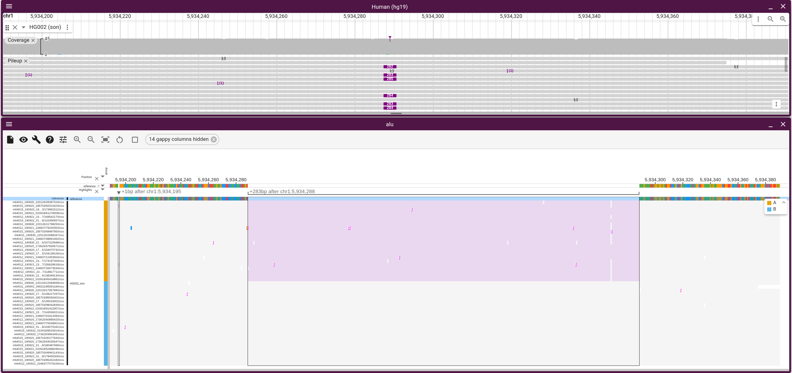
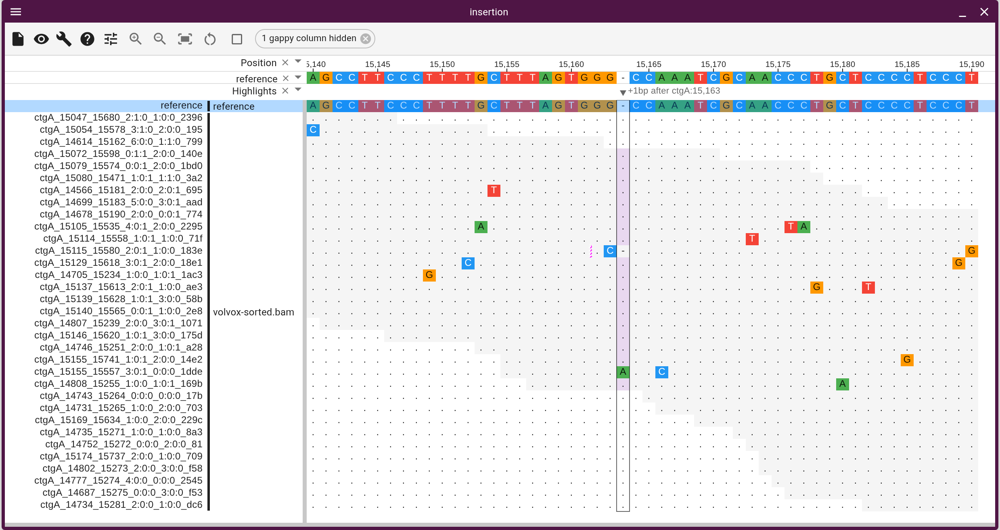

# Insertions

An Alu in an intron of NPHP4, in HG002's PacBio HiFi reads. JBrowse's pileup
above draws each read's copy as a purple box labelled with its length, 282 to
285bp in the reads on screen. The tview below aligns the copies to each other in
294 columns, where a base matching the other copies is a dot on purple, so the
copies read as one band and only the bases where a read differs keep their
colour. The rows without the insertion are blank across those columns. [Open
this one live][tview-demo-alu].

The GIAB HG002 structural-variant benchmark (v0.6, GRCh37) calls this a
heterozygous 283bp insertion after 1:5,934,288. We picked it from the
benchmark's heterozygous insertions of 280 to 330bp outside tandem repeats and
segmental duplications, by counting in each of the trio's BAMs the reads that
span each site and the reads with an insertion of 200bp or more within 100bp of
it. At this site 22 of HG002's 44 spanning reads have the insertion, 24 of his
father's 54 do, and none of his mother's 31 do, as [the same window in all
three][tview-demo-alu-trio] shows.

## How a site is laid out

Each insertion site is as wide as the longest sequence inserted there, after the
sequences are aligned to each other:

- **Inserted sequences are aligned to the most common one.** At each site, the
  sequence the most reads have is the centre, with ties going to the length
  nearest the median, and every other distinct sequence is aligned to it. The
  alignment is banded, so its time grows with length times divergence rather
  than with length squared. A site whose alignments would exceed a fixed work
  budget is left-justified instead. A site whose inserted sequence is copies of
  one unit is laid out a copy per block (see
  [Tandem repeats](tandem-repeats.md)).
- **Insertions are left-normalized.** An aligner can anchor the same `CA`
  inserted in a `CACACA` run at either end of the run. Each read's insertion is
  moved left through the read's bases for as long as the read spells the same
  sequence, so reads with the same event share one site. An insertion inside a
  tandem array stays where the array layout put it.
- **Near-duplicate sites are merged.** Left-normalization moves an insertion
  only as far as the read's bases allow, so a read with a sequencing error at
  the boundary, or one the aligner anchored a base or two off, would keep a
  separate site and give every other row a run of gaps as wide as the insertion.
  An insertion of 10bp or more is therefore moved to a site up to 25bp away that
  more reads use, when its length is within 20% of theirs and the move adds at
  most two mismatches against the reference to its row. The row still spells the
  read, and the move changes which of its bases count as inserted. Merging needs
  the reference sequence to count mismatches against.
- **A read that does not span a site is absent there.** In the alignment's text,
  a read that spans a site without inserting has `-` in its columns, and a read
  that does not span it has `.`.

At the Alu above, one read has an extra base just before its copy, and the
aligner placed the copy a base early, at a separate 287-column site. The merge
moves that copy to the site the other 21 reads use.

The volvox test reads at `ctgA:15,140..15,190`. The 1bp insertion after 15,163
has a column, bracketed as "+1bp after ctgA:15,163". The reads with the
insertion have a C there in all but one, drawn as dots on purple, and the one
read with another base shows it. Bases that match the reference are dots on
grey, and a row is white where its read has no base.

## Colours inside an insertion

Where the reference has no base, a base is read against the other reads in its
column. A base matching the column's commonest base, held by at least two reads
and by more than half of them, draws as a dot on purple, the colour JBrowse's
pileup draws an insertion in. An insertion most reads share is one purple band,
and the bases where a read differs keep their base colour. Copies of a tandem
repeat past the reference's count are drawn the same way, so an expansion is the
purple part of each row.

In a window of 20 reads or more, an inserted column only one read has a base in
is hidden, since it is read error and would cost every other row a column of
gaps. The read keeps an insertion marker there, and the reference's own columns
are always kept.

## Reads grouped by allele

Within each sample's band, reads that share alleles are grouped, and a coloured
strip beside the read names marks each group. In the Alu window, HG002's 22
reads with the insertion form one group above the 23 without it, and each group
matches one of the haplotypes GIAB's phasing tags the reads with.

- A site is a position in the window where at least a quarter of the sample's
  reads, and at least two, differ from the rest: a base, a deletion, or an
  insertion some reads have and others lack. At a tandem array the site is the
  copy count, split between the alleles the reads call (see
  [Tandem repeats](tandem-repeats.md)).
- Only sites spanned by at least half of the sample's reads count, so a few
  reads at the window's edge do not form a group.
- Each read joins the group whose alleles it contradicts least, with a site
  counting for more the more bases its event spans, so an Alu outweighs a
  scattered sequencing error.
- Groups are ordered the same way in every band, the group with the insertion or
  the longer allele first. A sample whose reads agree, such as a male at an X
  locus, gets no groups, and a read that spans none of the sites is listed after
  the groups.

Grouping does not assume a ploidy, and it reads only the bases in the window, so
two haplotypes that agree across the window are one group.

## Brackets

Each insertion site has a bracket in the Highlights strip above the alignment,
labelled with its size and the reference base it follows, such as
`+1bp after ctgA:15,163`. The size is the length most reads at the site insert:
HG002's reads have 280 to 287bp of the Alu above, and the bracket over its 294
columns reads `+283bp`. Each tandem array has a bracket labelled with its unit
and the reference's copy count, such as `(GCG)x21 in the reference`.

- In a noisy window, only the 100 sites with the most inserted sequence get a
  bracket.
- A one-column bracket is drawn as a triangle, and where brackets crowd, some
  are drawn without a label.
- Hovering a bracket outlines its columns, a click selects them, and a double
  click zooms to them.

<!-- demo-urls -->

[tview-demo-alu]:
  https://jbrowse.org/code/jb2/main/index.html?config=/demos/tview/config.json&session=spec-%7B%22sessionName%22%3A%22alu%22%2C%22views%22%3A%5B%7B%22id%22%3A%22lgv%22%2C%22type%22%3A%22LinearGenomeView%22%2C%22loc%22%3A%22chr1%3A5%2C934%2C190..5%2C934%2C390%22%2C%22assembly%22%3A%22hg19%22%2C%22tracks%22%3A%5B%7B%22trackId%22%3A%22HG002%22%2C%22displaySnapshot%22%3A%7B%22height%22%3A160%7D%7D%5D%7D%2C%7B%22id%22%3A%22tview%22%2C%22type%22%3A%22TView%22%2C%22displayName%22%3A%22alu%22%2C%22assembly%22%3A%22hg19%22%2C%22loc%22%3A%22chr1%3A5%2C934%2C190..5%2C934%2C390%22%2C%22tracks%22%3A%5B%7B%22trackId%22%3A%22HG002%22%2C%22sample%22%3A%22HG002_son%22%7D%5D%2C%22connectedViewId%22%3A%22lgv%22%2C%22height%22%3A900%2C%22colWidth%22%3A3%2C%22rowHeight%22%3A8%2C%22treeAreaWidth%22%3A220%7D%5D%7D
[tview-demo-alu-trio]:
  https://jbrowse.org/code/jb2/main/index.html?config=/demos/tview/config.json&session=spec-%7B%22sessionName%22%3A%22alu-trio%22%2C%22views%22%3A%5B%7B%22id%22%3A%22lgv%22%2C%22type%22%3A%22LinearGenomeView%22%2C%22loc%22%3A%22chr1%3A5%2C934%2C190..5%2C934%2C390%22%2C%22assembly%22%3A%22hg19%22%2C%22tracks%22%3A%5B%7B%22trackId%22%3A%22HG002%22%2C%22displaySnapshot%22%3A%7B%22height%22%3A55%7D%7D%2C%7B%22trackId%22%3A%22HG003%22%2C%22displaySnapshot%22%3A%7B%22height%22%3A55%7D%7D%2C%7B%22trackId%22%3A%22HG004%22%2C%22displaySnapshot%22%3A%7B%22height%22%3A55%7D%7D%5D%7D%2C%7B%22id%22%3A%22tview%22%2C%22type%22%3A%22TView%22%2C%22displayName%22%3A%22alu-trio%22%2C%22assembly%22%3A%22hg19%22%2C%22loc%22%3A%22chr1%3A5%2C934%2C190..5%2C934%2C390%22%2C%22tracks%22%3A%5B%7B%22trackId%22%3A%22HG002%22%2C%22sample%22%3A%22HG002_son%22%7D%2C%7B%22trackId%22%3A%22HG003%22%2C%22sample%22%3A%22HG003_father%22%7D%2C%7B%22trackId%22%3A%22HG004%22%2C%22sample%22%3A%22HG004_mother%22%7D%5D%2C%22connectedViewId%22%3A%22lgv%22%2C%22height%22%3A900%2C%22colWidth%22%3A3%2C%22rowHeight%22%3A5%2C%22treeAreaWidth%22%3A220%7D%5D%7D
[tview-demo-fmr1]:
  https://jbrowse.org/code/jb2/main/index.html?config=/demos/tview/config.json&session=spec-%7B%22sessionName%22%3A%22fmr1%22%2C%22views%22%3A%5B%7B%22id%22%3A%22lgv%22%2C%22type%22%3A%22LinearGenomeView%22%2C%22loc%22%3A%22chrX%3A146%2C993%2C530..146%2C993%2C670%22%2C%22assembly%22%3A%22hg19%22%2C%22tracks%22%3A%5B%7B%22trackId%22%3A%22HG002%22%2C%22displaySnapshot%22%3A%7B%22height%22%3A55%7D%7D%2C%7B%22trackId%22%3A%22HG003%22%2C%22displaySnapshot%22%3A%7B%22height%22%3A55%7D%7D%2C%7B%22trackId%22%3A%22HG004%22%2C%22displaySnapshot%22%3A%7B%22height%22%3A55%7D%7D%5D%7D%2C%7B%22id%22%3A%22tview%22%2C%22type%22%3A%22TView%22%2C%22displayName%22%3A%22fmr1%22%2C%22assembly%22%3A%22hg19%22%2C%22loc%22%3A%22chrX%3A146%2C993%2C530..146%2C993%2C670%22%2C%22tracks%22%3A%5B%7B%22trackId%22%3A%22HG002%22%2C%22sample%22%3A%22HG002_son%22%7D%2C%7B%22trackId%22%3A%22HG003%22%2C%22sample%22%3A%22HG003_father%22%7D%2C%7B%22trackId%22%3A%22HG004%22%2C%22sample%22%3A%22HG004_mother%22%7D%5D%2C%22connectedViewId%22%3A%22lgv%22%2C%22height%22%3A900%2C%22colWidth%22%3A6%2C%22rowHeight%22%3A8%2C%22treeAreaWidth%22%3A220%7D%5D%7D
[tview-demo-htt]:
  https://jbrowse.org/code/jb2/main/index.html?config=/demos/tview/config.json&session=spec-%7B%22sessionName%22%3A%22htt%22%2C%22views%22%3A%5B%7B%22id%22%3A%22lgv%22%2C%22type%22%3A%22LinearGenomeView%22%2C%22loc%22%3A%22chr4%3A3%2C076%2C570..3%2C076%2C730%22%2C%22assembly%22%3A%22hg19%22%2C%22tracks%22%3A%5B%7B%22trackId%22%3A%22HG002%22%2C%22displaySnapshot%22%3A%7B%22height%22%3A55%7D%7D%2C%7B%22trackId%22%3A%22HG003%22%2C%22displaySnapshot%22%3A%7B%22height%22%3A55%7D%7D%2C%7B%22trackId%22%3A%22HG004%22%2C%22displaySnapshot%22%3A%7B%22height%22%3A55%7D%7D%5D%7D%2C%7B%22id%22%3A%22tview%22%2C%22type%22%3A%22TView%22%2C%22displayName%22%3A%22htt%22%2C%22assembly%22%3A%22hg19%22%2C%22loc%22%3A%22chr4%3A3%2C076%2C570..3%2C076%2C730%22%2C%22tracks%22%3A%5B%7B%22trackId%22%3A%22HG002%22%2C%22sample%22%3A%22HG002_son%22%7D%2C%7B%22trackId%22%3A%22HG003%22%2C%22sample%22%3A%22HG003_father%22%7D%2C%7B%22trackId%22%3A%22HG004%22%2C%22sample%22%3A%22HG004_mother%22%7D%5D%2C%22connectedViewId%22%3A%22lgv%22%2C%22height%22%3A900%2C%22colWidth%22%3A6%2C%22rowHeight%22%3A8%2C%22treeAreaWidth%22%3A220%7D%5D%7D
[tview-demo-atxn3]:
  https://jbrowse.org/code/jb2/main/index.html?config=/demos/tview/config.json&session=spec-%7B%22sessionName%22%3A%22atxn3%22%2C%22views%22%3A%5B%7B%22id%22%3A%22lgv%22%2C%22type%22%3A%22LinearGenomeView%22%2C%22loc%22%3A%22chr14%3A92%2C537%2C320..92%2C537%2C420%22%2C%22assembly%22%3A%22hg19%22%2C%22tracks%22%3A%5B%7B%22trackId%22%3A%22HG002%22%2C%22displaySnapshot%22%3A%7B%22height%22%3A55%7D%7D%2C%7B%22trackId%22%3A%22HG003%22%2C%22displaySnapshot%22%3A%7B%22height%22%3A55%7D%7D%2C%7B%22trackId%22%3A%22HG004%22%2C%22displaySnapshot%22%3A%7B%22height%22%3A55%7D%7D%5D%7D%2C%7B%22id%22%3A%22tview%22%2C%22type%22%3A%22TView%22%2C%22displayName%22%3A%22atxn3%22%2C%22assembly%22%3A%22hg19%22%2C%22loc%22%3A%22chr14%3A92%2C537%2C320..92%2C537%2C420%22%2C%22tracks%22%3A%5B%7B%22trackId%22%3A%22HG002%22%2C%22sample%22%3A%22HG002_son%22%7D%2C%7B%22trackId%22%3A%22HG003%22%2C%22sample%22%3A%22HG003_father%22%7D%2C%7B%22trackId%22%3A%22HG004%22%2C%22sample%22%3A%22HG004_mother%22%7D%5D%2C%22connectedViewId%22%3A%22lgv%22%2C%22height%22%3A900%2C%22colWidth%22%3A7%2C%22rowHeight%22%3A8%2C%22treeAreaWidth%22%3A220%7D%5D%7D
[tview-demo-atxn3-hg004]:
  https://jbrowse.org/code/jb2/main/index.html?config=/demos/tview/config.json&session=spec-%7B%22sessionName%22%3A%22atxn3-hg004%22%2C%22views%22%3A%5B%7B%22id%22%3A%22lgv%22%2C%22type%22%3A%22LinearGenomeView%22%2C%22loc%22%3A%22chr14%3A92%2C537%2C320..92%2C537%2C420%22%2C%22assembly%22%3A%22hg19%22%2C%22tracks%22%3A%5B%7B%22trackId%22%3A%22HG004%22%2C%22displaySnapshot%22%3A%7B%22height%22%3A55%7D%7D%5D%7D%2C%7B%22id%22%3A%22tview%22%2C%22type%22%3A%22TView%22%2C%22displayName%22%3A%22atxn3-hg004%22%2C%22assembly%22%3A%22hg19%22%2C%22loc%22%3A%22chr14%3A92%2C537%2C320..92%2C537%2C420%22%2C%22tracks%22%3A%5B%7B%22trackId%22%3A%22HG004%22%2C%22sample%22%3A%22HG004_mother%22%7D%5D%2C%22connectedViewId%22%3A%22lgv%22%2C%22height%22%3A900%2C%22colWidth%22%3A7%2C%22rowHeight%22%3A8%2C%22treeAreaWidth%22%3A220%7D%5D%7D
[tview-demo-abca7]:
  https://jbrowse.org/code/jb2/main/index.html?config=/demos/tview/config.json&session=spec-%7B%22sessionName%22%3A%22abca7%22%2C%22views%22%3A%5B%7B%22id%22%3A%22lgv%22%2C%22type%22%3A%22LinearGenomeView%22%2C%22loc%22%3A%22chr19%3A1%2C049%2C460..1%2C050%2C000%22%2C%22assembly%22%3A%22hg19%22%2C%22tracks%22%3A%5B%7B%22trackId%22%3A%22HG003%22%2C%22displaySnapshot%22%3A%7B%22height%22%3A55%7D%7D%5D%7D%2C%7B%22id%22%3A%22tview%22%2C%22type%22%3A%22TView%22%2C%22displayName%22%3A%22abca7%22%2C%22assembly%22%3A%22hg19%22%2C%22loc%22%3A%22chr19%3A1%2C049%2C460..1%2C050%2C000%22%2C%22tracks%22%3A%5B%7B%22trackId%22%3A%22HG003%22%2C%22sample%22%3A%22HG003_father%22%7D%5D%2C%22connectedViewId%22%3A%22lgv%22%2C%22height%22%3A900%2C%22colWidth%22%3A1%2C%22rowHeight%22%3A16%7D%5D%7D

<!-- /demo-urls -->
