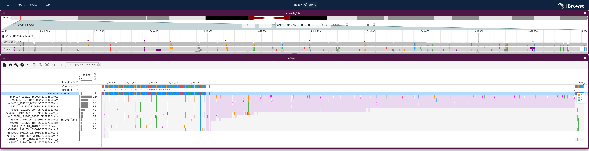
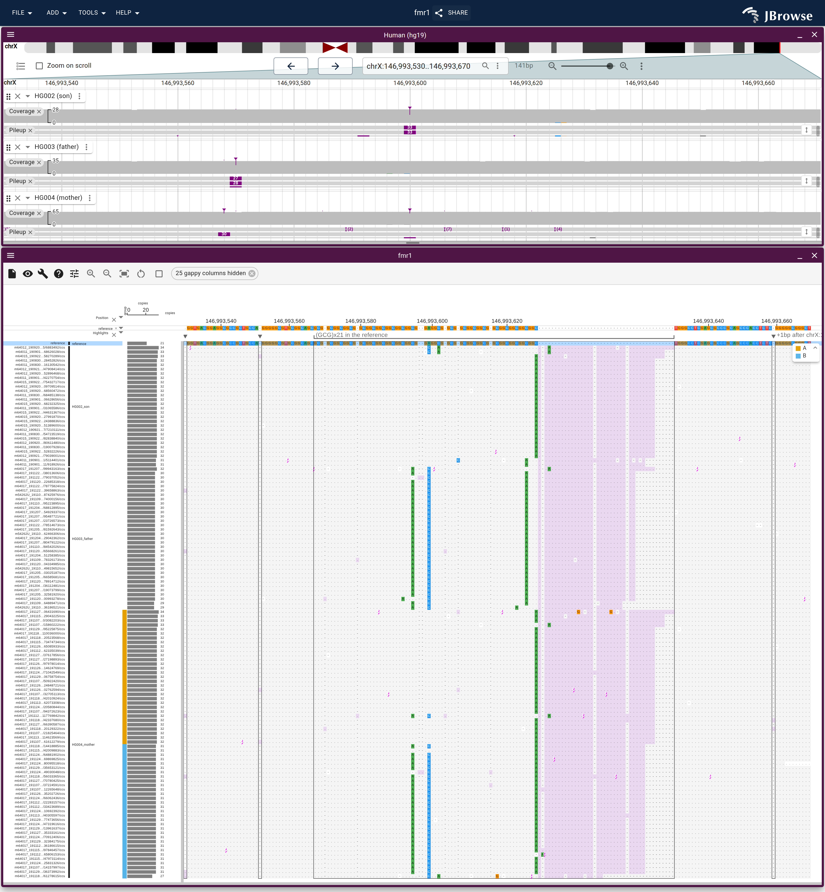

# Tandem repeats

The ABCA7 VNTR in HG003's PacBio HiFi reads, a copy per block of columns. Each
row's copy count is drawn as a bar and a number beside it, and the rows sort by
it, so the two alleles the genotype table below reports for HG003 are the steps
in the ladder, with a few reads between them. Laid out base by base, the same
reads would be 2.2kb of sequence with nothing to line the copies up. [Open this
one live][tview-demo-abca7].

## Each array is an interval on the reference

The view finds each array in the reference sequence. A row's allele is the
sequence the row has between the two ends of that interval: its matched bases,
plus what it inserted inside, minus what it deleted. That definition has these
consequences:

- **The count is the whole allele.** An STR is already in the reference, so a
  read's insertion is only how much more the read has than hg19, and a
  contracted allele inserts nothing, so the count is taken over the whole
  interval.
- **One locus is one array.** An indel inside an array has no unique placement,
  so an aligner anchors different reads at different positions, and a
  measurement over the interval gives the same count wherever it anchored them.
  Anchored on insertions instead, ATXN3 in HG002 came out as four separate
  arrays, with the locus's alleles split across four counts.
- **Insertions just outside the array are moved into it.** An aligner can anchor
  an expansion at the base before the array starts. That insertion would belong
  to no allele: it would get a run of columns outside the array, and its read
  would be counted as if it matched the reference. Before measuring, each read's
  insertions within a flank of 25bp or one copy, whichever is larger, are
  re-filed under the array, where the array's unit explains the inserted
  sequence. At ATXN3 this applies to most reads with an expansion, and it
  changes HG004 from 8/8 with three odd reads to 8/21.

  The interval itself stays fixed, because it is a property of the reference, so
  one read's misplaced insertion affects only that read. Widening the interval
  instead let a single spurious copy, anchored two bases early, move the array's
  left edge for every row and change the reference's own copy count.

- **Every spanning read is counted**, including reads that match the reference
  exactly. Those are usually the most common allele, and a method keyed on
  insertions does not see them.
- **The reference is a row**, laid out and counted like any other allele, and
  the column coordinates are its positions.

The view scans for periods from 2 to 300bp, and the shortest period that
explains a stretch wins. It skips homopolymers, which are periodic at every lag,
so any unit would be an arbitrary cut through one run.

At each array:

- **Copy k of every row is in the same block**, so one divergent copy shows up
  as a column instead of shifting every later copy.
- **Each row's copy count is drawn beside it**, as a bar in the `copies` panel
  and a number in the `n` panel.
- **Rows sort by copy count, most copies first**, within each sample's band, so
  the alleles form a ladder. Rows with the same count are ordered by
  [allele group](insertions.md#reads-grouped-by-allele), which uses the copy
  count as one of its sites.
- **The column width starts at the width that fits the alignment in about
  3,000px**, between 1 and 10px, so most of a long array is on screen.

**Blocks are numbered in array order, which does not imply homology.** Copies
are counted from the left edge of the interval, and an array can expand or
contract anywhere inside it, so the 9th copy of one row need not be the 9th copy
of another. Comparing copies along a row is sound; comparing one block across
rows is a hypothesis.

## Copy counts in the GIAB trio

`pnpm report:repeats` measures the GIAB Ashkenazi trio (PacBio HiFi, GRCh37) at
known loci with the same plan builder the view runs. `pnpm readme:repeats`
writes every number in this section, and `pnpm readme:repeats --check` fails
when they differ from a fresh measurement. The `Measurements` workflow runs that
check weekly and whenever the plan builder changes. It is left out of
Integration and `preversion`, so a GIAB outage does not block a commit or a
release.

An allele is a copy count with at least 15% of a sample's spanning reads, and
more than one read. Reads scatter around an allele, so each allele also takes
the reads within a tenth of its size whose count has less than a third of its
support. Both rules are needed: FMR1's mother's two alleles are one copy apart,
and so is the shoulder either side of HTT's single allele, so only relative
support tells the two cases apart. The result describes the reads and is not a
genotype call. It has no notion of ploidy, so a homozygote and a haploid locus
each give one number. Read that way, every locus with variation to check is
Mendelian:

<!-- repeat-genotypes -->

| locus            | ref | HG003 (father) | HG004 (mother) | HG002 (son) |
| ---------------- | --- | -------------- | -------------- | ----------- |
| HTT (CAG)        | 33  | 31             | 31 / 38        | 31 / 38     |
| ATXN3 (CTG)      | 8   | 15 / 17        | 8 / 21         | 17 / 21     |
| TCF4 CTG18.1     | 38  | 25 / 46        | 28 / 38        | 28 / 46     |
| DMPK (CTG)       | 21  | 12 / 14        | 6 / 12         | 12          |
| FMR1 (CGG), X    | 21  | 30             | 31 / 32        | 32          |
| C9orf72 (GGGGCC) | 4   | 3              | 3              | 3           |
| ABCA7 VNTR       | 19  | 20 / 88        | 21 / 25        | 21          |

<!-- /repeat-genotypes -->

FMR1 is the strongest check, because the layout has no input saying which
chromosome a locus is on, yet the two males come back with one allele each and
the mother with two, and the son's allele is one of hers.

## Limitations

- **The interval is whatever scans as periodic, which can differ from a curated
  locus definition.** HTT's CAG tract and the CCG tract after it are both period
  3, so they form one array, and its count spans both and will not match a
  published CAG size.
- **Some reads land off the alleles**, from slippage in the read and in the
  aligner. `pnpm report:repeats` prints every copy count with its support, so
  read the distribution instead of one row.
- **Long VNTR alleles are noisy and have few reads.** A row is counted only if
  it spans the interval end to end, so an array of a 25bp unit running past 2kb
  is measured on a handful of reads, each of which had to read all of it
  correctly. The last two columns show both effects:

<!-- repeat-spread -->

| locus            | array              | spanning reads | on an allele | off one |
| ---------------- | ------------------ | -------------- | ------------ | ------- |
| HTT (CAG)        | 97bp of 3bp unit   | 176            | 176          | 0       |
| ATXN3 (CTG)      | 24bp of 3bp unit   | 154            | 149          | 5       |
| TCF4 CTG18.1     | 113bp of 3bp unit  | 169            | 141          | 28      |
| DMPK (CTG)       | 62bp of 3bp unit   | 129            | 129          | 0       |
| FMR1 (CGG), X    | 62bp of 3bp unit   | 123            | 122          | 1       |
| C9orf72 (GGGGCC) | 23bp of 6bp unit   | 210            | 210          | 0       |
| ABCA7 VNTR       | 466bp of 25bp unit | 27             | 20           | 7       |

<!-- /repeat-spread -->

At ABCA7 the reads off an allele come from that same handful of reads, so they
show the noise at that locus and do not compare as a proportion with the STRs
above.

The long ABCA7 alleles are real sequence. Read at base level, the 1,207bp and
764bp insertions the aligner anchored 19bp outside the array in HG003 are copies
of the VNTR's 25bp unit, entered at offset 6. They are expansions rather than
chimeric joins or mismappings, which is why the count depends on re-filing them
under the array.

## Several samples in one alignment

The FMR1 CGG repeat in the GIAB Ashkenazi trio, with all three files in one
alignment. Rows are grouped in a band per sample, labelled in the gutter beside
the read names, with the reference in a separate band on top, and the rows in
each band sort by copy count. A band takes its name from the `sample` given for
its track in the view's `init`, or else from the track. FMR1 is on the X, so
each male's band shows one allele and the mother's shows two, with the counts in
the genotype table above. [Open this one live][tview-demo-fmr1].

The repeat figures use these settings:

- **Columns with a base in only one row are hidden**, which the view also does
  for inserted columns once there are 20 rows. react-msaview's gap threshold is
  set to the percentage that means one row for the number of rows, because a
  column takes the same width whether 124 rows use it or one does. Those columns
  are read error, and the rows with such a base keep an insertion marker in its
  place. The columns in each figure:

<!-- repeat-figures -->

| figure                                       | rows | columns | columns one row has | hidden |
| -------------------------------------------- | ---- | ------- | ------------------- | ------ |
| [fmr1](../img/repeat-fmr1-trio.png)          | 124  | 218     | 24                  | 11%    |
| [htt](../img/repeat-htt-trio.png)            | 182  | 222     | 25                  | 11%    |
| [atxn3](../img/repeat-atxn3-trio.png)        | 157  | 159     | 18                  | 11%    |
| [atxn3-hg004](../img/repeat-atxn3-hg004.png) | 53   | 145     | 4                   | 3%     |
| [abca7](../img/repeat-abca7-vntr.png)        | 16   | 3630    | 1253                | 35%    |

<!-- /repeat-figures -->

- **The label column is 220px** in all but the ABCA7 figure, so long read names
  are cut in the middle. Without the setting, the view fits the column to the
  widest name.
- **The window is sized to the alignment.** A JBrowse view taller than its
  window cuts off its last rows with no indication, and the last rows are the
  last band, a whole sample. `pnpm figures:giab` grows the window to the content
  and warns when it cannot.

<!-- demo-urls -->

[tview-demo-alu]:
  https://jbrowse.org/code/jb2/main/index.html?config=/demos/tview/config.json&session=spec-%7B%22sessionName%22%3A%22alu%22%2C%22views%22%3A%5B%7B%22id%22%3A%22lgv%22%2C%22type%22%3A%22LinearGenomeView%22%2C%22loc%22%3A%22chr1%3A5%2C934%2C190..5%2C934%2C390%22%2C%22assembly%22%3A%22hg19%22%2C%22tracks%22%3A%5B%7B%22trackId%22%3A%22HG002%22%2C%22displaySnapshot%22%3A%7B%22height%22%3A160%7D%7D%5D%7D%2C%7B%22id%22%3A%22tview%22%2C%22type%22%3A%22TView%22%2C%22displayName%22%3A%22alu%22%2C%22assembly%22%3A%22hg19%22%2C%22loc%22%3A%22chr1%3A5%2C934%2C190..5%2C934%2C390%22%2C%22tracks%22%3A%5B%7B%22trackId%22%3A%22HG002%22%2C%22sample%22%3A%22HG002_son%22%7D%5D%2C%22connectedViewId%22%3A%22lgv%22%2C%22height%22%3A900%2C%22colWidth%22%3A3%2C%22rowHeight%22%3A8%2C%22treeAreaWidth%22%3A220%7D%5D%7D
[tview-demo-alu-trio]:
  https://jbrowse.org/code/jb2/main/index.html?config=/demos/tview/config.json&session=spec-%7B%22sessionName%22%3A%22alu-trio%22%2C%22views%22%3A%5B%7B%22id%22%3A%22lgv%22%2C%22type%22%3A%22LinearGenomeView%22%2C%22loc%22%3A%22chr1%3A5%2C934%2C190..5%2C934%2C390%22%2C%22assembly%22%3A%22hg19%22%2C%22tracks%22%3A%5B%7B%22trackId%22%3A%22HG002%22%2C%22displaySnapshot%22%3A%7B%22height%22%3A55%7D%7D%2C%7B%22trackId%22%3A%22HG003%22%2C%22displaySnapshot%22%3A%7B%22height%22%3A55%7D%7D%2C%7B%22trackId%22%3A%22HG004%22%2C%22displaySnapshot%22%3A%7B%22height%22%3A55%7D%7D%5D%7D%2C%7B%22id%22%3A%22tview%22%2C%22type%22%3A%22TView%22%2C%22displayName%22%3A%22alu-trio%22%2C%22assembly%22%3A%22hg19%22%2C%22loc%22%3A%22chr1%3A5%2C934%2C190..5%2C934%2C390%22%2C%22tracks%22%3A%5B%7B%22trackId%22%3A%22HG002%22%2C%22sample%22%3A%22HG002_son%22%7D%2C%7B%22trackId%22%3A%22HG003%22%2C%22sample%22%3A%22HG003_father%22%7D%2C%7B%22trackId%22%3A%22HG004%22%2C%22sample%22%3A%22HG004_mother%22%7D%5D%2C%22connectedViewId%22%3A%22lgv%22%2C%22height%22%3A900%2C%22colWidth%22%3A3%2C%22rowHeight%22%3A5%2C%22treeAreaWidth%22%3A220%7D%5D%7D
[tview-demo-fmr1]:
  https://jbrowse.org/code/jb2/main/index.html?config=/demos/tview/config.json&session=spec-%7B%22sessionName%22%3A%22fmr1%22%2C%22views%22%3A%5B%7B%22id%22%3A%22lgv%22%2C%22type%22%3A%22LinearGenomeView%22%2C%22loc%22%3A%22chrX%3A146%2C993%2C530..146%2C993%2C670%22%2C%22assembly%22%3A%22hg19%22%2C%22tracks%22%3A%5B%7B%22trackId%22%3A%22HG002%22%2C%22displaySnapshot%22%3A%7B%22height%22%3A55%7D%7D%2C%7B%22trackId%22%3A%22HG003%22%2C%22displaySnapshot%22%3A%7B%22height%22%3A55%7D%7D%2C%7B%22trackId%22%3A%22HG004%22%2C%22displaySnapshot%22%3A%7B%22height%22%3A55%7D%7D%5D%7D%2C%7B%22id%22%3A%22tview%22%2C%22type%22%3A%22TView%22%2C%22displayName%22%3A%22fmr1%22%2C%22assembly%22%3A%22hg19%22%2C%22loc%22%3A%22chrX%3A146%2C993%2C530..146%2C993%2C670%22%2C%22tracks%22%3A%5B%7B%22trackId%22%3A%22HG002%22%2C%22sample%22%3A%22HG002_son%22%7D%2C%7B%22trackId%22%3A%22HG003%22%2C%22sample%22%3A%22HG003_father%22%7D%2C%7B%22trackId%22%3A%22HG004%22%2C%22sample%22%3A%22HG004_mother%22%7D%5D%2C%22connectedViewId%22%3A%22lgv%22%2C%22height%22%3A900%2C%22colWidth%22%3A6%2C%22rowHeight%22%3A8%2C%22treeAreaWidth%22%3A220%7D%5D%7D
[tview-demo-htt]:
  https://jbrowse.org/code/jb2/main/index.html?config=/demos/tview/config.json&session=spec-%7B%22sessionName%22%3A%22htt%22%2C%22views%22%3A%5B%7B%22id%22%3A%22lgv%22%2C%22type%22%3A%22LinearGenomeView%22%2C%22loc%22%3A%22chr4%3A3%2C076%2C570..3%2C076%2C730%22%2C%22assembly%22%3A%22hg19%22%2C%22tracks%22%3A%5B%7B%22trackId%22%3A%22HG002%22%2C%22displaySnapshot%22%3A%7B%22height%22%3A55%7D%7D%2C%7B%22trackId%22%3A%22HG003%22%2C%22displaySnapshot%22%3A%7B%22height%22%3A55%7D%7D%2C%7B%22trackId%22%3A%22HG004%22%2C%22displaySnapshot%22%3A%7B%22height%22%3A55%7D%7D%5D%7D%2C%7B%22id%22%3A%22tview%22%2C%22type%22%3A%22TView%22%2C%22displayName%22%3A%22htt%22%2C%22assembly%22%3A%22hg19%22%2C%22loc%22%3A%22chr4%3A3%2C076%2C570..3%2C076%2C730%22%2C%22tracks%22%3A%5B%7B%22trackId%22%3A%22HG002%22%2C%22sample%22%3A%22HG002_son%22%7D%2C%7B%22trackId%22%3A%22HG003%22%2C%22sample%22%3A%22HG003_father%22%7D%2C%7B%22trackId%22%3A%22HG004%22%2C%22sample%22%3A%22HG004_mother%22%7D%5D%2C%22connectedViewId%22%3A%22lgv%22%2C%22height%22%3A900%2C%22colWidth%22%3A6%2C%22rowHeight%22%3A8%2C%22treeAreaWidth%22%3A220%7D%5D%7D
[tview-demo-atxn3]:
  https://jbrowse.org/code/jb2/main/index.html?config=/demos/tview/config.json&session=spec-%7B%22sessionName%22%3A%22atxn3%22%2C%22views%22%3A%5B%7B%22id%22%3A%22lgv%22%2C%22type%22%3A%22LinearGenomeView%22%2C%22loc%22%3A%22chr14%3A92%2C537%2C320..92%2C537%2C420%22%2C%22assembly%22%3A%22hg19%22%2C%22tracks%22%3A%5B%7B%22trackId%22%3A%22HG002%22%2C%22displaySnapshot%22%3A%7B%22height%22%3A55%7D%7D%2C%7B%22trackId%22%3A%22HG003%22%2C%22displaySnapshot%22%3A%7B%22height%22%3A55%7D%7D%2C%7B%22trackId%22%3A%22HG004%22%2C%22displaySnapshot%22%3A%7B%22height%22%3A55%7D%7D%5D%7D%2C%7B%22id%22%3A%22tview%22%2C%22type%22%3A%22TView%22%2C%22displayName%22%3A%22atxn3%22%2C%22assembly%22%3A%22hg19%22%2C%22loc%22%3A%22chr14%3A92%2C537%2C320..92%2C537%2C420%22%2C%22tracks%22%3A%5B%7B%22trackId%22%3A%22HG002%22%2C%22sample%22%3A%22HG002_son%22%7D%2C%7B%22trackId%22%3A%22HG003%22%2C%22sample%22%3A%22HG003_father%22%7D%2C%7B%22trackId%22%3A%22HG004%22%2C%22sample%22%3A%22HG004_mother%22%7D%5D%2C%22connectedViewId%22%3A%22lgv%22%2C%22height%22%3A900%2C%22colWidth%22%3A7%2C%22rowHeight%22%3A8%2C%22treeAreaWidth%22%3A220%7D%5D%7D
[tview-demo-atxn3-hg004]:
  https://jbrowse.org/code/jb2/main/index.html?config=/demos/tview/config.json&session=spec-%7B%22sessionName%22%3A%22atxn3-hg004%22%2C%22views%22%3A%5B%7B%22id%22%3A%22lgv%22%2C%22type%22%3A%22LinearGenomeView%22%2C%22loc%22%3A%22chr14%3A92%2C537%2C320..92%2C537%2C420%22%2C%22assembly%22%3A%22hg19%22%2C%22tracks%22%3A%5B%7B%22trackId%22%3A%22HG004%22%2C%22displaySnapshot%22%3A%7B%22height%22%3A55%7D%7D%5D%7D%2C%7B%22id%22%3A%22tview%22%2C%22type%22%3A%22TView%22%2C%22displayName%22%3A%22atxn3-hg004%22%2C%22assembly%22%3A%22hg19%22%2C%22loc%22%3A%22chr14%3A92%2C537%2C320..92%2C537%2C420%22%2C%22tracks%22%3A%5B%7B%22trackId%22%3A%22HG004%22%2C%22sample%22%3A%22HG004_mother%22%7D%5D%2C%22connectedViewId%22%3A%22lgv%22%2C%22height%22%3A900%2C%22colWidth%22%3A7%2C%22rowHeight%22%3A8%2C%22treeAreaWidth%22%3A220%7D%5D%7D
[tview-demo-abca7]:
  https://jbrowse.org/code/jb2/main/index.html?config=/demos/tview/config.json&session=spec-%7B%22sessionName%22%3A%22abca7%22%2C%22views%22%3A%5B%7B%22id%22%3A%22lgv%22%2C%22type%22%3A%22LinearGenomeView%22%2C%22loc%22%3A%22chr19%3A1%2C049%2C460..1%2C050%2C000%22%2C%22assembly%22%3A%22hg19%22%2C%22tracks%22%3A%5B%7B%22trackId%22%3A%22HG003%22%2C%22displaySnapshot%22%3A%7B%22height%22%3A55%7D%7D%5D%7D%2C%7B%22id%22%3A%22tview%22%2C%22type%22%3A%22TView%22%2C%22displayName%22%3A%22abca7%22%2C%22assembly%22%3A%22hg19%22%2C%22loc%22%3A%22chr19%3A1%2C049%2C460..1%2C050%2C000%22%2C%22tracks%22%3A%5B%7B%22trackId%22%3A%22HG003%22%2C%22sample%22%3A%22HG003_father%22%7D%5D%2C%22connectedViewId%22%3A%22lgv%22%2C%22height%22%3A900%2C%22colWidth%22%3A1%2C%22rowHeight%22%3A16%7D%5D%7D

<!-- /demo-urls -->
