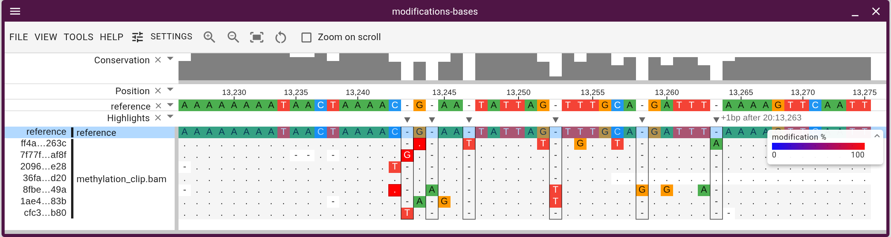

# Using the view

## Opening a tview

Install the plugin, then open a tview in one of three ways:

- **From an alignments track.** The track menu (vertical `...`) has **Launch
  tview for visible region**, which opens the view at once over the region in
  view. It is disabled, with the reason beneath it, when the region is wider
  than 20,000bp or spans more than one region.
- **From a selection.** Drag across the genome view's ruler to select a region,
  then choose **Launch** -> **Tview of all alignments tracks**, which reads
  every alignments track open in that view into one alignment.
- **From a session or a link**, with no click path (see
  [below](#as-a-session-with-no-click-path)).

While it builds, the view says what it is waiting for. When it cannot load a
region, it shows why in place of the alignment, with a retry button where
retrying can help. Besides the 20,000bp limit, an alignment is refused past 25
million cells (rows times columns), since every read is a full-width row.

## The view's menu

The view's own menu (the hamburger on its title bar) changes what it shows:

- **Tracks** ticks which alignments tracks the view reads: those open in the
  genome view it came from, and any others it already reads. The menu keeps at
  least one ticked.
- **Show the connected view's current region** rebuilds the view over whatever
  the genome view is showing now, with the same limits as the track menu.
- **Zoom to base level on click?** switches a click on a column between centring
  the genome view there and zooming it to that base.
- **Base modifications** appears when the reads have calls (see
  [below](#base-modifications)).

## Linked to the genome view

The view stays connected to the genome view it came from:

- Hovering a column highlights that position in the genome view, and a click
  keeps it highlighted and moves the genome view there.
- Hovering the genome view highlights that base of the reference row in the
  alignment.
- The **Position** ruler above the alignment numbers the columns in the genome's
  coordinates, and so do its tooltips and the **Go to row or column** box. A
  column the reference has no base in, such as an inserted one, gets no tick.

## As a session, with no click path

A tview is defined by a locus, an assembly and the tracks to read, so a session
can declare one. In a `defaultSession` or a saved session, these go in the
view's `init` block:

```json
{
  "type": "TView",
  "init": {
    "assembly": "hg19",
    "loc": "chrX:146,993,530..146,993,670",
    "tracks": [
      { "trackId": "HG002", "sample": "HG002_son" },
      { "trackId": "HG003", "sample": "HG003_father" }
    ]
  }
}
```

A [session spec](https://jbrowse.org/jb2/docs/urlparams/) URL takes the same
keys at the top level of the view, following JBrowse's convention for every view
type:

```json
{
  "type": "TView",
  "assembly": "hg19",
  "loc": "chrX:146,993,530..146,993,670",
  "tracks": ["HG002"]
}
```

`assembly`, `loc` and `tracks` are required, and a spec missing one fails with
"A TView spec needs an assembly name, a loc string and a tracks array of
trackIds". A track is a trackId or `{ trackId, sample }`, where `sample` names
its band. Every other key is passed to the view as is, such as
`connectedViewId`, `colWidth` or `rowHeight`, and the view is titled with its
locus unless `displayName` says otherwise.

In both forms the view loads the alignment itself. A saved session stores `init`
and never the alignment, so a restored session rebuilds the alignment from
`init`.

`public/repeats.json` is a working example, with the GIAB trio on hosted hg19
and a tview at FMR1 open on load.

## Base modifications

When the reads have MM/ML tags, the view places each read's most probable call
at each base on that base, inserted bases included. Hovering a cell names the
call, such as `5mC 97%`. Each called base is filled on a scale from blue (0%) to
red (100%) of its call's probability, with a legend, and the view's menu gains a
**Base modifications** submenu:

- **Over base colors**, the default, keeps the base colour of every mismatch
  with no call. A mismatching T is red too, so a red cell is a call where it
  holds a dot, a C or a G.
- **Without base colors** fills the called bases and nothing else.



Seven nanopore reads from `public/methylation_clip.bam`. The red G in the second
read sits in the column bracketed after 20:13,243, a base the reference does not
have; the read is on the reverse strand, so its called C reads as a G.

The calls have limits:

- **At most 50,000 calls per view.** Past that the least probable are left out,
  and the menu says how many.
- **A row whose letters are not one unbroken run of its read's sequence gets no
  calls**, since a call projected onto it could land on the wrong base. That
  happens inside a tandem array, where a read's insertion was re-filed into the
  array or the row has no allele for a block. The menu counts these rows as "not
  annotated".
- **One call per base.** A base called as both 5mC and 5hmC shows the more
  probable of the two.

## Requirements

A JBrowse v5 host: `@jbrowse/core` 5.0.0 or later. No v5 is released yet (npm's
`latest` is 4.3.0), so today that means
[JBrowse Web nightly](https://jbrowse.org/code/jb2/main/) or a `5.0.0-beta`
build from npm's `next` tag; this version was built and tested against
5.0.0-beta.23.
